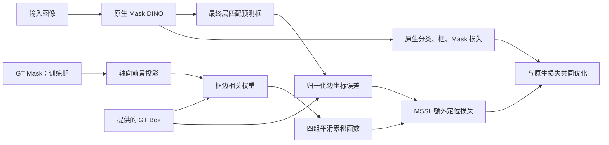

# MSSL V1：基于掩码方向性支持的框定位监督

**冻结归档（2026-10-20）：** 公式与常数未变；实际训练源码、五组配置/权重身份和最新结果统一见[发布索引](mssl_v1_release_20261020.md)。

版本：2026-10-19，方法定义冻结稿。对应已经完成训练的 Mask-Supported Side Localization（MSSL V1）。
本文固定数学定义、实现层级和适用条件；PolypGen 行为分析已于2026-10-19完成，未反向修改公式。经验性解释另见分析报告，不作为下面命题的前提。正文统一使用“方向性前景支持”，不将轴向投影称为完整二维轮廓、边界真值分布或定位不确定性。

## 写作提纲与段落功能

1. 任务与动机：解释为什么使用 Mask 提供优化信息，但仍以提供的 Box 为定位目标。
2. 方向性前景支持：由 GT Mask 轴向投影和到框边的距离得到固定权重。
3. 非线性坐标误差变换：给出额外损失和挂载位置。
4. 理论性质：目标一致性、梯度方向、局部曲率、条件性内外向差异及饱和边界。
5. 训练与推理：说明实例可靠性、超参数、共享数据协议及原生推理保留。
6. 与相关定位方法的区别和证据边界：分开表达数学结论与待验证的性能解释。

| 步骤 | 输入→输出 | 设计动机 | 可严格说明的性质 |
|---|---|---|---|
| 方向支持 | GT Mask、提供 GT Box→四组固定轴向权重 | 使用矩形标签没有表达的前景空间分布 | 同一 Box 下，不同轴向 Mask 分布可产生不同的误差变换 |
| 坐标变换 | 预测边误差、固定权重→四个 CDF 差 | 使偏移大小和方向参与优化信号构造 | 单边目标不变、局部等价于条件坐标加权；远处有界且可能饱和 |
| 原生框路径监督 | 最终层已匹配预测→额外标量损失 | 直接作用于已有框回归路径 | 无新增可学习参数；复用原生匹配 |

可直接导出的流程图：[PDF](figures/mssl_v1/mssl_v1_pipeline.pdf)、[SVG](figures/mssl_v1/mssl_v1_pipeline.svg)、[PNG](figures/mssl_v1/mssl_v1_pipeline.png)。

## 1. 任务设定与方法概述

**动机。** 本研究考虑训练期可获得像素级病灶掩码的单帧息肉目标检测。提供的 Bounding Box 定义评估采用的正确框坐标，而 Mask 补充前景在矩形内部及附近的空间分布。由于二者不一定严格具有相同的外接边界，直接将 Mask 极值作为新的框目标会改变检测监督语义。MSSL 保留提供的框标签，通过 Mask 条件的坐标误差变换向原生框回归路径提供额外监督。

**设计。** MSSL 从增强后的 GT Mask 构造四组相对于提供框边的方向性支持，将预测框边与 GT 框边映射到同一平滑累积函数，并约束两者的函数值相等。该损失只附加于最终 Decoder 层已经匹配的原生预测，原有分类、L1、GIoU、Mask、辅助层和去噪损失保持原样。

**范围。** MSSL 的“方向性”来自四条框边分别构造的支持权重，不引入学习到的边界分布头。轴向投影不能保留完整二维轮廓：具有相同两个轴向投影的 Mask，可能产生相同的监督。因此本文称其为方向性前景支持，不将其等同于完整二维形状理解或预测框不确定性估计。

## 2. GT Mask 的方向性前景支持

设增强后的一幅图像对应二值掩码 \(M\in\{0,1\}^{H\times W}\)，提供框为
\(b^*=(e_l^*,e_t^*,e_r^*,e_b^*)\)。所有量使用同一增强后像素坐标系，Mask 补边为零。两个轴向前景质量为

\[
m_x(u)=\sum_v M(v,u),\qquad m_y(v)=\sum_u M(v,u).
\]

像素中心取 \(u=k+\tfrac12\)。对框边 \(e\in\{l,t,r,b\}\)，使用对应轴的投影 \(m_e\)，并令

\[
s_e=\max(e_r^*-e_l^*,s_{\min})\quad(e=l,r),\qquad
s_e=\max(e_b^*-e_t^*,s_{\min})\quad(e=t,b).
\]

定义支持点相对位置 \(r_e(u)=(u-e_e^*)/s_e\)。只在 \(m_e(u)>0\) 的支持点上，计算

\[
\pi_e(u)=
\frac{m_e(u)\exp(-|r_e(u)|/\beta)}
{\sum_{v:m_e(v)>0}m_e(v)\exp(-|r_e(v)|/\beta)}.
\]

实现中对 \(\log m_e(u)-|r_e(u)|/\beta\) 做 softmax，以减少框与 Mask 边界不一致时指数权重下溢。\(\pi_e\)、\(s_e\) 和所有 GT 量均停止梯度。左右边共享同一横向投影，但参考位置不同，因此权重不同；上下边同理。

该构造将较靠近相应框边的前景质量赋予更高权重，但不要求提供框边必须穿过前景，也不将框外支持点预先视为错误。只要存在非空有效支持，提供框与 Mask 外接框不一致不影响下面的目标一致性结论。

## 3. 非线性框边定位损失

对预测边 \(\hat e_e\)，定义归一化坐标误差

\[
d_e=(\hat e_e-e_e^*)/s_e.
\]

给定温度 \(\tau>0\)，构造平滑累积函数

\[
G_e(d)=\sum_u\pi_e(u)\,\sigma\!\left(\frac{d-r_e(u)}{\tau}\right).
\]

它可解释为以 GT 前景支持点为中心的 Logistic 核混合的累积函数；不是网络预测的边界后验。单边额外损失为

\[
\ell_e(d_e)=\frac12\left[G_e(d_e)-G_e(0)\right]^2.
\]

设一个微批次最终层匹配中满足可靠性条件的目标集合为 \(\mathcal E\)，则

\[
\mathcal L_{\mathrm{MSSL}}=
\frac{1}{\max(|\mathcal E|,1)}
\sum_{i\in\mathcal E}\frac14\sum_{e\in\{l,t,r,b\}}\ell_{i,e},
\qquad
\mathcal L=\mathcal L_{\mathrm{native}}+\lambda\mathcal L_{\mathrm{MSSL}}.
\]

空集合时额外项为与原生预测保持计算图连接的零。\(\mathcal L_{\mathrm{native}}\) 保留全部原生损失及其权重；MSSL 不替换 L1/GIoU。原生匹配直接复用，不新增一次 Hungarian 指派，也不对中间层、Encoder Proposal 或去噪预测重复施加该项。

原生预测仍采用归一化 cxcywh，损失内部转换到像素 xyxy。四边损失的梯度经可微转换返回原生回归头，未增加独立预测头。因而四边的梯度在中心和宽高参数上会组合，不能把四条边视为完全独立的网络参数。

## 4. 理论性质及适用条件

下列命题固定 GT、支持权重、\(s_e>0\) 和 \(\tau>0\)，讨论实数精确算术下的单边函数。它们不假设或保证非凸网络训练的最终结果。

### 4.1 定位目标一致性与梯度方向

有限位置处的 Logistic 导数为正，因此

\[
G'_e(d)=\frac1\tau\sum_u\pi_e(u)q_u(d)[1-q_u(d)]>0,
\quad q_u(d)=\sigma((d-r_e(u))/\tau).
\]

\(G_e\) 严格递增，故 \(\ell_e(d)=0\iff d=0\)。提供的 GT 边是该单边额外项唯一的零损失位置，即使 GT Box 与 Mask 外接框不一致也成立。另外，

\[
\ell'_e(d)=[G_e(d)-G_e(0)]G'_e(d),\qquad
\operatorname{sign}(\ell'_e(d))=\operatorname{sign}(d)\quad(d\ne0).
\]

单边梯度下降方向指向提供的 GT 边。但多实例、多任务共享参数会改变优化折中；不能据此推导联合网络最优参数不变、必然收敛到更优解或 AP 必然提高。FP32/FP16 实现中的数值饱和也可能使理论上非零的导数变为零。

例如，若一个共享标量参数同时拟合目标0与1，平方误差之和在0.5处最小；改变两个样本的正权重通常会改变该共享最优点，尽管每个样本单独的零误差目标都未改变。这说明“逐样本目标一致”与“联合参数最优点相同”是不同命题。

### 4.2 局部曲率与静态加权对照

记 \(a_e=G'_e(0)>0\)、\(b_e=G''_e(0)\)。在正确边附近，

\[
\ell_e(d)=\frac12a_e^2d^2+\frac12a_eb_ed^3+O(d^4),\qquad
\ell''_e(0)=a_e^2.
\]

所以主导项正是 Mask 条件的静态坐标加权，而非新的坐标标签。Mask-static 对照采用 \(\tfrac12a_e^2d^2\)，匹配原损失的局部二阶项，保持四边及有效目标归一化。若改为 L1 或 Smooth L1，便不再是当前函数的同一局部近似。

若以像素坐标而非归一化误差求导，分别需要额外乘 \(1/s_e\) 和 \(1/s_e^2\) 的一阶、二阶因子。因此尺度归一化也是当前实现的一部分，不能在对照中遗漏。

### 4.3 条件性内外向不对称

一般有

\[
G''_e(0)=\frac1{\tau^2}\sum_u\pi_e(u)q_u(0)[1-q_u(0)][1-2q_u(0)].
\]

若某左/上边的全部支持位于该边内侧，则 \(r_e(u)\ge0\)，有 \(G_e(0)\le1/2\)、\(G''_e(0)\ge0\)。相同大小的较小向内偏移可比向外偏移产生更强的局部损失，三阶项描述了该差异。右/下边在全部支持位于内侧时 \(r_e(u)\le0\)，对应方向相反。

这一性质依赖支持的单侧条件及偏移范围；实际提供框可能带有标注边距，Mask 也可能越过提供框边。不能声称所有实例都具有相同的内缩/外扩惩罚关系，更不能不经测量就把检测中的某种偏差归因于它。

### 4.4 有界性、梯度界与饱和

记 \(q=G_e(0)\in(0,1)\)。有

\[
\lim_{d\to-\infty}\ell_e(d)=\tfrac12q^2,
\qquad
\lim_{d\to+\infty}\ell_e(d)=\tfrac12(1-q)^2,
\qquad
|\ell'_e(d)|\le\frac1{4\tau}.
\]

大偏移下 \(G'_e(d)\to0\)，所以额外项会饱和。它与数学上随 \(|d|\) 增长的静态平方项具有不同的远距离行为；不能只凭局部等价认定两者训练效果相同，也不能把有界性当作对所有网络参数梯度或 AMP 数值稳定性的保证。\(\partial\ell/\partial\theta\) 还包含原生预测对参数的 Jacobian。

这些性质解释了需要保留原生回归约束，也给出了可测量的风险，但不构成泛化保证。当前没有主张该单边函数全局凸。

## 5. 固定实现与实验适配

| 项目 | MSSL V1 固定定义 |
|---|---|
| 额外项 | GT Mask 支持，CDF 差的半平方 |
| 超参数 | \(\lambda=1.0,\tau=0.05,\beta=0.15,s_{\min}=4\) 个增强后像素 |
| 挂载 | 最终 Decoder 层原生匹配框；无中间层/Encoder/DN 的额外副本 |
| Mask 输入 | 训练期 GT；无预测 Mask 教师 |
| 新增参数 | 0；复用原生框回归路径 |
| 推理 | 原生 Mask DINO，包含预测 Mask 和原生分类×Mask质量打分 |

这些 MSSL 常数为事先固定的研究设置，不是 Mask DINO 官方参数或经目标域搜索的最优值。官方配置继承部分与 MSSL 研究设置必须分开表述。

**标签可靠性。** 原始单框 Kvasir 图像的语义 Mask 以灰度大于 127 二值化，不裁剪到 GT Box，并供所有对照组的原生 Mask Loss 使用。原始多框图像沿用已有适配器的语义标签处理，排除于额外 MSSL 项；增强后只剩一个目标也不会重新成为可靠单框样本。空 Mask、退化框不施加额外项。这是对语义标签的适配，不是假定获得了独立实例分割标注。

**训练协议。** 四组共同采用 Seed42、Kvasir 880/120 划分、50 等效 epoch=2750 优化器迭代、相同 ImageNet R50 初始化及原生优化设置。12GB GPU 使用 microbatch1×累积16；它保留每个微批次的原生归一化和 DN 构造，不等价于物理 batch16。各组遵循相同适配，并记录 AMP 跳步。Checkpoint 按 Kvasir Val bbox AP50:95 最大值选择，不按 AP75 或 PolypGen 选择。

**推理协议。** 输入只有图像，不需要 GT Box/Mask。MSSL 训练损失不参与推理，但原生预测 Mask 计算及其质量打分仍保留。没有新增推理参数和结构操作，不等于在任意系统上已经通过速度测试证明绝对相同延迟。训练可能经共享表征间接影响预测 Mask 和最终排序，因此高 IoU AP 的变化不能预先全部归为坐标改善。

当前单类配置先按分类分数从300个 Query 中选择100个候选，再以原生融合分数排序。Mask 打分是预测前景内的平均概率：

\[
s_{\mathrm{mask}}=
\frac{\sum_p\sigma(\hat m_p)\mathbf1[\hat m_p>0]}
{\sum_p\mathbf1[\hat m_p>0]+10^{-6}},\qquad
s_{\mathrm{final}}=s_{\mathrm{cls}}s_{\mathrm{mask}}.
\]

这里是原生置信度启发式，不是实际 GT Mask IoU 或新增的定位质量预测头。因此本轮分数反事实保留同一原生候选集合，只分析打分变化；全300 Query 框则另作筛选前几何诊断。

## 6. 对照、相关路线与经验性解释

Box-CDF 保留相同函数、温度、带宽和额外项权重，只把轴向支持替换为提供 GT Box 矩形的连续像素单元占比；它仍保留原生 GT Mask 监督。Mask-static 保留精细 Mask 支持，替换为上述局部二阶项。两组分别检验当前函数中精细支持的增量，以及完整非线性相对自身局部近似的增量；不证明 Mask 信息不可被任何其他方法替代。

原生 L1/GIoU 已是成熟的 Box-only 定位约束，MSSL 在其上增加 GT 支持条件的坐标变换。[GIoU](https://arxiv.org/abs/1902.09630) 依赖两个框的几何关系；MSSL 的额外项使用框之外的精细监督，但不替换提供的框目标。

[GFL/DFL](https://proceedings.neurips.cc/paper_files/paper/2020/hash/f0bda020d2470f2e74990a07a607ebd9-Abstract.html) 学习框位置的分布表示；MSSL 不新增分布预测头，而由固定 GT 支持构造误差变换。[DSC](https://openaccess.thecvf.com/content/CVPR2021/html/Ding_Deeply_Shape-Guided_Cascade_for_Instance_Segmentation_CVPR_2021_paper.html) 利用预测 Mask 引导后续检测；MSSL 的路径是训练期 GT 支持到原生框损失的梯度。上述是机制区别，不是完整查新的替代，本文不使用“首次”声明。

新增近邻：[Mask-Based IoU for Bounding Box Regression Using Medical Images](https://dergipark.org.tr/en/pub/tjmcs/article/1423292)（2024）提出同时考虑框面积与目标Mask覆盖的MbIoU度量。原文§4.2主要比较选定图像和框位置下的度量值；§5将用该度量开展检测器训练与测试列为未来工作，因此不能当作已有完整训练收益的证据。它说明“将Mask信息引入医学框回归”已有先例。MSSL的具体比较落点应是固定方向性前景支持、以提供框边为唯一单边零点的平滑CDF误差变换，以及原生匹配路径上的辅助梯度，而非宽泛的Mask辅助检测。该区别不是穷尽查新结论。

经验性结论由 [四组归因报告](../runs/mssl-attribution-20261018-r2/summary.md) 和 [已完成的跨域行为报告](../runs/mssl-polypgen-analysis-20261019/summary.md) 分开承载。后者显示MSSL相对基线的全300 Query高IoU覆盖和前排覆盖提高；但全300 Query在IoU≥.90的覆盖不高于Box-CDF或Mask-static。固定候选框后使用分类分数的AP优势仍存在，支持排除“收益全部来自最终Mask重打分”的单一解释，不能唯一分解几何、筛选和排序的因果贡献。相对Box-CDF总体AP差值的图像级95%区间包含零；AP90差异仅作探索性证据。PolypGen为已观察过的外部评估基准，不能当作完全未参与研究决策的独立确认集。CIoU竞争比较已完成；当前状态与后续独立外测边界见 [发布索引](mssl_v1_release_20261020.md)。

补充Box-only近邻：[CFIoU](https://doi.org/10.3390/s23104961)具有真实检测器训练实验，但其“foreground area”在公式中由GT矩形框的面积关系表达，不使用精细像素Mask。应作为角点/面积几何优化讨论，不能写成与MSSL相同的精细Mask监督来源。CIoU-Replace的调用范围与PICCOLO获取/void规则核对见[执行前审查](mssl_ciou_piccolo_review_20261019.md)。

## 7. 复现与证据映射

- [本次冻结方法契约](../runs/mssl-polypgen-analysis-20261019/mssl_v1_contract.json)：作用层级、常数、输入与推理路径。
- 原始实际训练实现：`runs/mssl-implementation-20261018/campaign-r2/source/methods/mssl/`；无需以当前工作区代码替换已训练版本。
- [公式与实际训练代码数值核对](../runs/mssl-polypgen-analysis-20261019/math_verification.json)：含 Box/Mask 边距的 FP32 损失和梯度与解析式比较。数值核对辅助发现实现错配，不能替代数学证明。

| Claim | Evidence | Status |
|---|---|---|
| 单边零损失目标是提供的框边 | §4.1 严格单调证明，实际代码数值核对 | supported，在给定条件/实数算术下 |
| 局部等价于 Mask 条件平方误差 | §4.2 Taylor 展开，已完成静态对照 | supported；全程等价不成立 |
| 内外向响应可不同 | §4.3 条件性推导，固定GT曲线 | supported，不能无条件推广 |
| 无新增预测头/参数，原生推理路径保留 | 冻结实现、原生 forward 继承与推理一致性验收 | supported，未据此声称实测延迟数值 |
| 当前四组中有性能增量 | 四组原始结果与固定协议 | supported，限当前 Seed/数据/指标，有退化例外 |
| 跨域收益全部来自框坐标改善 | 需定位/筛选/排序联合诊断 | 不作此声明 |
| 跨训练随机性稳定、对未知域必然改善 | 缺少重复训练和完全独立确认 | 不作此声明 |
| 具体公式具有足够独立新颖性 | 已有近邻区别；仍需定向文献比较 | needs evidence，不使用“首次” |

## 8. 逆向提纲与审稿式自检

**竞争验证更新（2026-10-20）：** [CIoU-Replace五组报告](../runs/ciou-competition-20261019/summary.md)已完成。MSSL相对该实现的PolypGen AP差值+1.136点，图像级95%区间[+0.209,+2.033]；AP90差值+2.357点，区间[+0.815,+3.804]。AP75/AP95差值区间含零，源域AP90为CIoU较高，不能宣称统一定位精度或全指标优势。该比较是实用竞争验证，不是单变量Mask/CDF消融；Box-CDF的总体AP差值不确定性仍保留。方法公式未改变，独立外测和跨Seed结论仍待验证。

逆向提纲：监督信息差异 → 轴向方向支持 → 保持目标的误差变换 → 数学性质及反例边界 → 原生训练/推理契约 → 对照与经验解释分离。每个技术段只支撑这条链中的一个环节。

| 维度 | 自检问题及回答 | 状态 |
|---|---|---|
| 贡献 | 是否把“Mask帮助检测”本身当创新？没有；贡献限定到具体支持构造和梯度路径，仍需近邻审查 | needs evidence |
| 清晰度 | 能否由公式复现？像素中心、尺度、支持归一化、四边/有效目标平均、层级和常数均列明 | pass |
| 实证强度 | 是否隐藏总体AP小增幅或外测AP75例外？不隐藏，五组结果完整提供，不作唯一因果解释 | pass for scope；CIoU比较已完成，独立泛化待验证 |
| 评估完整性 | 两项归因对照及CIoU-Replace竞争比较均已完成；完全独立的大数据外测仍待安排 | independent evaluation still needed |
| 设计合理性 | 是否把目标一致性当联合收敛/泛化保证？没有；饱和、信息压缩、可靠实例限制与数值精度均保留 | pass for stated claims |
