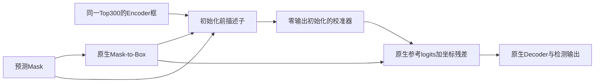

# 第二机制规格 v0：空间支持条件的参考框校准

状态：**规格、独立CPU原型及真实Detector工程验收已完成；尚未进行新训练。** 工程结果见[support_reference_engineering_execution_20261021.md](support_reference_engineering_execution_20261021.md)。本文的工作名称不是已经成立的方法贡献。MSSL V1及原生Mask-to-Box仍是正式参照；现有队列未增加训练任务。

写作提纲：观测与假设 → 最近邻约束 → 输入和前向 → 监督与梯度 → 工程验收 → 有限训练对照与停止点。本文用于审查实现，不作为论文已经验证的Method。

## 1. 现在究竟要验证什么

全量PolypGen固定权重干预已经否定了“普遍替换或平均初始化即可实用提点”：MSSL原生AP49.751，Encoder-only25.616，固定0.5融合37.541；融合的AP90由29.805降到0.767。这不否定匹配训练的校准器，但要求它从原生有效几何出发。

CPU审计提供的是候选信号，不是开关。低Mask占用在六中心与源域方向较稳定；但MSSL前10 Query的融合恢复排序AP仅.0328，基数.0200，正常和无效候选很多。不能直接把低占用映射为“相信Encoder”。完整证据见[审计决策](initialization_identifiability_decision_20261021.md)。

**唯一核心假设：在原生Mask参考框周围，预测Mask沿横纵轴的空间支持分布，能否比只看两个框和全局占用率，更好地学习初始化几何修正？** 空间分布用于判别修正方向和幅度，不要求所有息肉具有高占用，也不惩罚稀疏或细长形状本身。

“低占用具有诊断关联”已观察；“方向分布提供额外可学习信息”尚未验证；“校准后总体AP提升且保护高精度”尚未验证。没有把碎片、高光、边界模糊等具体成因当成已证实事实。

## 2. 最近邻与新颖性边界

本轮定向核对论文/作者资料，检索截止2026-10-21；不是穷尽查新。以下来源均为论文、正式出版页或作者代码。

| 工作 | 已有内容 | 对本设计的约束 |
|---|---|---|
| [Mask DINO, CVPR2023](https://arxiv.org/abs/2206.02777) / [固定Decoder源码](https://github.com/IDEA-Research/MaskDINO/blob/3831d8514a3728535ace8d4ecc7d28044c42dd14/maskdino/modeling/transformer_decoder/maskdino_decoder.py) | Mask增强框初始化、混合匹配 | 不能声称首次用Mask初始化、首次联合Box/Mask |
| [DI-MaskDINO, NeurIPS2024](https://arxiv.org/abs/2410.16707) | 平衡检测/分割的早期Query与特征优化 | 不能把“早期Query影响最终结果”或一般任务平衡当新贡献 |
| [BoxInst, CVPR2021](https://arxiv.org/abs/2012.02310) | 用Box投影约束Mask，并利用像素关系 | 单纯增加Mask投影/外接范围损失不足以形成新机制 |
| [WeakMed, CVPR2026](https://openaccess.thecvf.com/content/CVPR2026/html/Wei_Rethinking_Box_Supervision_Bias-Free_Weakly_Supervised_Medical_Segmentation_CVPR_2026_paper.html) | 训练期可微Mask-to-Box与尺度一致性，用于Box监督医学分割 | “可微Mask-to-Box”“训练期Box约束Mask”也不是可直接认领的创新；本轮只核对正式摘要/论文可检索内容，不声称已逐式比对全部实现 |
| [Mask Scoring R-CNN, CVPR2019](https://arxiv.org/abs/1903.00241) | 预测Mask质量并校准最终分数 | 普通质量头是成熟设计；改用在初始化仍需独立机制证据 |
| [D-FINE, ICLR2025](https://arxiv.org/abs/2410.13842) | 分布式框细化与定位自蒸馏 | 不能把一般坐标细化或方向分布表示本身称为首次 |

**当前新颖性结论：普通MLP残差校准器属于工程候选，本身不足以支持第二创新。** 值得研究的区别仅在“预测Mask的有序空间支持是否对参考框校准具有独立价值，以及它如何改变候选覆盖/精定位取舍”。应用位置不同不自动等于方法新颖。若只证实多一个回归头有效，最多保留为工程结果。

## 3. 前向规格与独立原型

原型：[support_reference_prototype.py](../polypbench/analysis/support_reference_prototype.py)。它没有注册到模型/CLI/队列，不读取数据或checkpoint，不运行Detector。固定参数：16 bins、64维隐藏层、5444个参数；这些是可检验的v0实现选择，不是经PolypGen调优的最优配置。

### 3.1 输入、空间描述与坐标

对每个普通Query，只接收初始化前张量：预测Mask logits \(m_q\)、实际Encoder参考logits \(r_q^e\)、原生Mask参考logits \(r_q^m\)，以及映射到Mask格点的有效图像区域。没有GT、最终分数、最终框、干预输出或事后GT归属输入。所有300 Query都按同一前向处理，不先用GT或Top10筛选。

令 \(H_q=\mathbf1[m_q>0]\)，\(S_q=\sigma(m_q)H_q\)。在原生二值支持的整数外接矩形内，沿x/y方向分别将H和S的质量投影积分到16个等宽区间，并对每种投影归一化到总质量1，共64维。空支持为0向量。实现用分段常量像素质量的前缀积分，避免缩小采样丢掉单个极端像素。这里不是对GT CDF施加MSSL损失。

再加入16维标量：Encoder/Mask实际sigmoid参考各4维；Mask占用率、前景占全画布比例、前景落在padding中的比例、空Mask标记、单行/单列退化标记、Encoder坐标到0/1边界标记、有效图像行/列比例。原生padding前景保留在空间描述中，单独标记其比例，不擅自清除或重新提框。

描述子可区分某些“同框、同占用率、不同方向分布”的Mask；不能恢复全部二维形状，也不能判断连通性。形状不同但横纵投影相同的情况仍无法区分。这是该v0的明确表达能力限制。

框坐标使用**原生实际参考张量**，不再次提取后冒充相同参考；Encoder允许原生±inf logits经sigmoid形成边界参考。NaN/非法Mask参考必须报错。GT框继续使用原生prepare_targets的坐标定义；接入时须验证LSJ画布和有效尺寸映射，不能自行更换为另一个归一化分母。

### 3.2 校准与默认行为

描述子 \(z_q\) 和参考基值都停止梯度。校准器为80→64→4的ReLU MLP，最后一层权重及偏置为0：

\[
\delta_q=h_\theta(\operatorname{sg}(z_q)),\qquad
r_q'=\operatorname{sg}(r_q^m)+\delta_q,\qquad b_q'=\sigma(r_q').
\]

四个输出是原生cxcywh参考的logit残差；不是四条边互相独立的可信度，也不是Encoder与Mask之间的凸组合系数。Encoder仅作为上下文，不被当作正确目标。这个v0没有新Quality Head、切换阈值、占用率筛选或手工融合比例。

零初始化时参考数值与原生相同，但**仅保证起点，不能保证训练后不误伤好框**。每个坐标sigmoid后保持有效范围；换算xyxy后仍可能超出画布，按原生Decoder处理，不新增结果驱动的裁剪。

空Mask和单行/单列支持固定旁路为原生参考，不回退Encoder，不承担本版修复目标。这样牺牲这部分潜在收益以先收紧范围；报告必须列出旁路率。非空但低占用不旁路。模块有额外推理参数和计算，不能声称零开销。

构造MLP保留外部CPU随机数状态，避免额外初始化改变已有数据增强/Detector的随机序列；接入时还需检查GPU和训练端随机状态。禁用模块必须走原生分支，不做多余数值往返。

## 4. 监督与梯度：先复用原生路径

精确挂载位置：原生Mask-to-Box转换完成后、普通Query与DN参考框拼接前。Top300索引、content queries、Encoder interm_outputs保持原样。DN GT加噪框不能经过校准器。INITIAL_PRED仍保留，输出序列长度不变。

原生aux_outputs[0]是Decoder前的initial prediction，pred_boxes直接是初始参考框sigmoid，而不是第一个真实Decoder层输出。原生Criterion会为它独立匹配，并计算既有L1/GIoU。v0拟复用这两项及其原生外部权重，不增加一套质量标签或新监督系数：

\[
L_{\mathrm{total}}=L_{\mathrm{native}}(r')+[L_{\mathrm{MSSL}}\text{，仅组合组开启}].
\]

这仍然改变了优化：原生aux0的框由硬Mask转换得到，没有可训练回归路径；有了校准器，该项能更新新增参数。不能因为损失名称/权重不变，就说梯度强度和原生完全相同。

未匹配Query没有直接的aux0框回归目标；它们仍受共享校准参数及后续检测损失影响。v0没有额外加入未匹配Query身份正则来掩盖这一问题，背景与正常候选的大基数是必须保留的风险。身份初始化不能替代训练后误伤统计。

| 路径 | v0预期 | 验收所需证据 |
|---|---|---|
| aux0框L1/GIoU → 校准器 | 直接更新新增参数 | 真实Criterion按loss分解检查，不能用合成反传代替 |
| 第一个真实Decoder层的参考位置/注意力 → 校准器 | 可能传梯度 | 原生Decoder内逐层detach，必须实际测量，不能声称所有层参考路径贯通 |
| 后层损失 → 校准器 | 可能经hidden states等路径传递 | 检查逐loss梯度范数及有限性；不擅自删除detach |
| 校准描述子 → Encoder/Mask预测头 | 主动detach，新增描述路径不更新它们 | 独立原型验证；原生自身分类/Mask/框损失继续正常工作 |
| MSSL | 仍仅最终普通层 | 不复制到校准器、aux0、Encoder、DN |

零输出末层使第一次反传主要更新末层；隐藏层梯度初始为0是预期。原型验证末层变化后隐藏层可接收梯度，这只是数学连通性，不是实际Detector收敛证据。

新增分支本身只需GT Box，不要求精细实例Mask：沿用aux0原生一对一匹配得到Box目标；原生匹配本身仍使用其既定Mask标签。多目标语义Mask的身份不足不能被抹去，但此处没有强行把语义Mask拆成新实例标签。它不改变MSSL原有835单目标/45多目标图的资格规则，也不能声称解决了多实例训练缺额。

不另外使用PolypGen GT制作修正标签、门控阈值或蒸馏目标。880张Kvasir Train、941个Box有基本的框监督来源。工程面板中已观察到有效匹配及真实aux0梯度，但尚不证明总体训练充分。这里区分两种空Mask：预测支持空/退化按v0旁路；LSJ将GT Mask裁空但仍保留有效provided Box时，仅记录Mask缺额，仍沿用原生框监督，不能将GT状态输入推理分支。原先把这两种情况统称“旁路”的文字已修正。

## 5. 工程验收与停止点

本轮仅完成独立CPU数学检查，不导入Mask DINO、未调用GPU、没有优化器或模型训练。测试位于[test_support_reference_prototype.py](../tests/test_support_reference_prototype.py)。

已在本机WSL Ubuntu-22.04、PyTorch2.7.1+cu128运行`python -m unittest tests.test_support_reference_prototype -v`，**10项全部通过**：零初始化参考一致/参数量、构造保留CPU RNG、空和退化支持旁路、质量积分保留单像素、同框同占用的空间描述差异、Encoder原生无穷logits边界、padding前景可见、梯度隔离及后续隐藏层连通、非凸组合坐标能力、非有限Mask报错。合成测试不意味着真实Detector已通过。

下一次接入验收须按顺序完成：

1. 在隔离开关下接入，不改third_party原文件。禁用和零输出模式与原生逐图核对Top300/content、初始化参考、最终框、原始分类与Mask融合分数；不能仅比较AP。训练模式验证DN单独拼接及所有输出/损失数量一致。新增adapter键以外不允许静默漏载checkpoint。
2. 固定Kvasir Train小面板（按GT面积、单/多目标及固定LSJ种子选取，不按预测恢复挑选），进行无optimizer的forward/backward。记录aux0匹配数、有效/旁路数量、框质量分布及按loss分解的adapter/原生参数梯度。PolypGen不参与此步。
3. 核对描述子坐标、有效区域在LSJ和padding下的对应；检查NaN、空Mask、单像素、边界Encoder、AMP与批次维度。测实耗时/峰值显存。原型5444参数不代替推理开销测量。
4. 若出现失配、无有效梯度、有效训练信号极少，停止进入完整训练。先定位工程问题或否定该v0，不能通过新阈值过滤困难例来制造可学习性。

这是一项固定验收，不再扩展PolypGen可识别性统计或扫bins/阈值。通过后才确定完整训练预算；本文件没有将任何50epoch任务加入队列。

## 6. 最小实验怎样支持或否定机制

不能只跑“Baseline+头”和“MSSL+头”就声称第二创新。需要排除一般参数/回归头收益及初始化策略重训收益。

| 阶段/组 | 目的 | 约束 |
|---|---|---|
| 已有Baseline与MSSL V1 | 原生参照 | 保留原始checkpoint选择规则 |
| Baseline + 固定0.5初始化，同预算重训 | 排除仅训练适应即可利用融合的解释 | 和此前冻结权重干预分开报告，不扫系数 |
| Baseline + 几何校准对照 | 检查普通框/全局占用回归是否已足够 | 同80→64→4结构，将64维有序profile置零，保留全部16维标量；同参数存储但有效输入不同，不能称严格等有效容量 |
| Baseline + 支持条件校准 | 验证空间支持有无独立增量 | 只改变profile信息，其他路径、损失、预算相同 |
| MSSL + 支持条件校准（后置） | 检验互补性 | 仅在独立组有值得保留的整体收益后开展 |

前面三项新增Baseline组不是现在启动的队列。固定置乱profile bins对全连接MLP只是输入重排，可由权重重排抵消，**不能作为破坏空间信息的消融**；撤回此前这一建议。本版先保留标量几何对照，不另加置乱实验，不得看到PolypGen结果后无限追加消融。概念新颖性仍需与最近邻逐式比较，任何这组实验都不能单独证明“首次”。

完整比较如获启动，应从同一原始预训练初始化、同数据/seed42/50等效epoch/优化器/增强与Kvasir Val选点协议训练；不能把旧检测器短微调与已有50epoch原生直接当公平胜负。若选择微调试验，所有对照必须同起点同微调预算，结论只限微调。

主要性能为PolypGen全量bbox AP50:95；同时报告AP50/75/90、GT覆盖恢复/新增丢失/净变、高精度保护、重复FP和负图误报，按中心、面积和单/多目标保留不利子集。候选覆盖改善不代替AP。Kvasir Val仅辅助和选checkpoint，不升为主要性能结论。PolypGen是外部开发基准；PolypsSet/PolypDB继续保留。

停止规则：支持校准不优于普通几何头，或只以大幅牺牲精定位换粗覆盖，则停止把空间支持称为第二创新；组合无互补就不强行组合。单seed的小幅增量不足以证明可重复收益，若结果值得发展再安排独立seed确认。不给当前未运行实验预设涨点幅度。

## 7. 主张—证据与五维自审

| 主张 | 证据 | 状态 |
|---|---|---|
| 原生Mask初始化有精定位价值，简单全局干预有严重取舍 | 已完成全量三条件结果 | 支持，限固定权重 |
| 低占用是初始化前诊断线索 | 全量CPU审计含正常候选及六中心 | 支持关联，不支持门控 |
| 空间profile含全局标量没有的信息 | 合成同框/同占用样本的描述子差异 | 仅数学支持，不是医学样本可学习证据 |
| 校准器可由框监督更新 | 独立CPU反传 | 仅原型支持；真实Criterion/DN/AMP待验收 |
| 能保护原生高精度并提高AP | 尚无新模块推理/训练 | 未支持 |
| 是独立第二创新、与MSSL互补 | 最近邻约束及未来消融 | 未支持，不写入论文贡献 |

1. **贡献**：目前仍可能只是普通小型框细化头。用标量几何对照检验profile的独立价值；不成立则降为工程结果。
2. **清晰度**：输入限初始化前；输出是cxcywh logit残差；旁路规则及挂载位置固定；没有可靠性标量头或GT选择推理Query。
3. **实验强度**：只有既有审计与合成CPU合同，尚无真实梯度、收敛、多seed和AP证据，不能宣布有效。
4. **评价完整性**：后续要保留正常候选基数、覆盖净得失和精定位代价；最终独立数据集尚未使用。
5. **方法合理性**：复用aux0回归提供明确目标，detach限定新增路径，身份起点减少初始扰动；这不保证源域可学习、跨域泛化或训练后安全。当前最需解决的是工程路由与源域监督有效性，而不是再拟合PolypGen规则。
